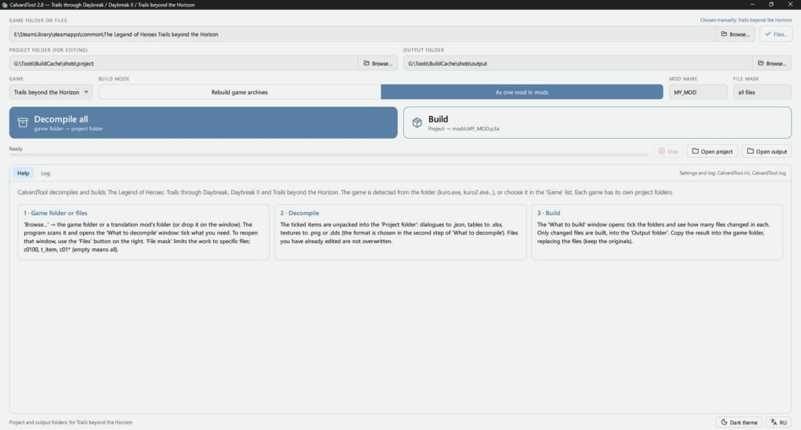
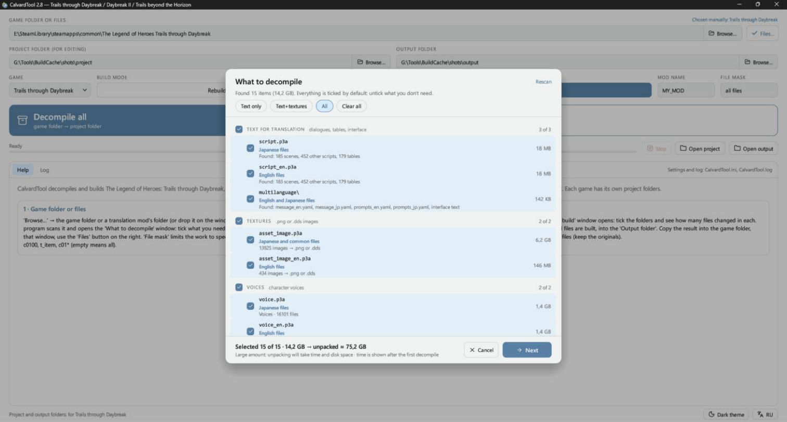
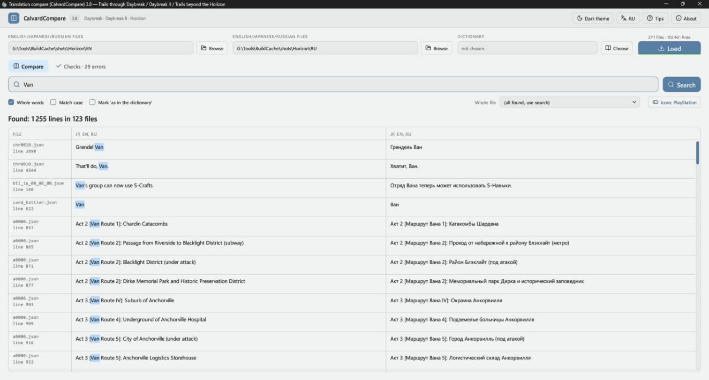
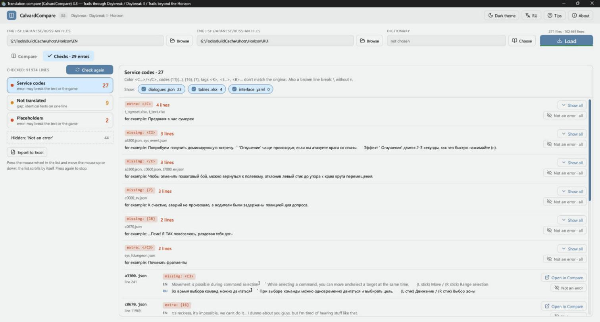

# CalvardTool

**English** · [Русский](README_RU.md)

Building, extraction and proofreading of texts for The Legend of Heroes games (PC, Steam): Trails through Daybreak, Trails through Daybreak II and Trails beyond the Horizon.

| Program | What it does |
|---|---|
| **CalvardTool** (`CalvardTool.exe`) | Unpacks the game's `.p3a` archives into editable files and builds your edits back into game archives or a single mod. |
| **CalvardCompare** (`CalvardCompare.exe`) | Shows the text of two languages side by side, with search, a dictionary and automatic translation checks. It only reads translation files and never writes to them. |

The interface is in English and Russian. It starts in English; the **RU / EN** button at the bottom of CalvardTool and at the top of CalvardCompare switches the language, and the choice is remembered. CalvardCompare's checks and dictionary are built around a Russian translation: they treat Cyrillic text as translated and compare English against Russian.

Both programs need Windows and a graphics card with OpenGL 2 or later. They may not start in virtual machines.

## Contents

- [Screenshots](#screenshots)
- [Quick start](#quick-start)
- [CalvardTool](#calvardtool-1)
- [CalvardCompare](#calvardcompare)
- [Command line](#command-line)
- [Building from source](#building-from-source)
- [Credits](#credits)

## Screenshots

CalvardTool:





CalvardCompare:





## Quick start

1. Download the archives from [Releases](../../releases) and unpack them anywhere. `data.dat` must stay next to `CalvardCompare.exe`: it holds the game icons and portraits shown in the text.
2. In CalvardTool, choose the game folder under **Game folder or files**, or drop the folder on the window.
3. In the **What to decompile** window, tick what you need.
4. Set the **Project folder (for editing)** and a separate **Output folder**.
5. Click **Decompile all** and edit the files in the project folder.
6. Click **Build**, tick the folders in the **What to build** window and build.
7. Copy the result into the game folder, replacing the files.

Keep a copy of the originals: Steam may restore changed archives when it verifies the files.

Full guides: [CalvardTool](docs/ReadMe_CalvardTool.txt), [CalvardCompare](docs/ReadMe_CalvardCompare.txt). In Russian: [CalvardTool](docs/ReadMe_CalvardTool_RU.txt), [CalvardCompare](docs/ReadMe_CalvardCompare_RU.txt).

## CalvardTool

### Supported games

| Game | Detected by | Text folders |
|---|---|---|
| Trails through Daybreak | `kuro.exe` | `script_en`, `table_en` |
| Trails through Daybreak II | `kuro2.exe` | `script_en`, `table_en` |
| Trails beyond the Horizon | `kai.exe` or `script_eng.p3a` | `script_eng`, `table_eng` |

The game is detected automatically, or you can choose it in the **Game** list. Each game has its own project and output folders, and a project folder won't accept another game's files.

### What becomes what

| Content | In the game | For editing | Edit with |
|---|---|---|---|
| Dialogues and scripts | `.dat` | `.json` | Notepad++ or any text editor |
| Tables | `.tbl` | `.xlsx` | Excel or WPS |
| Textures | `.dds` | `.png`, or `.dds` as it is | Any image editor; for `.dds`, one with DDS support |
| Interface text | `multilanguage\message_en.yaml` | `.yaml` | Any text editor |
| Models, effects, sounds | as they are | as they are | Put your file with the same name in place of the old one |

Rules for editing:

- **Dialogues:** translate only the strings in `"text"`. `\n` is a line break. Keep `{11}{1180}` and other `{numbers}` in place, and don't touch `<C1>`, `<W500>` and other tags. `"code"` and `"ln"` are internal fields.
- **Tables:** on the `Text` sheet, column A says where the string is, B is the text to edit and C is the original. Don't touch hidden column D or the `_internal` sheet, and don't delete or reorder rows.
- **Textures:** save `.png` with transparency, and preferably at the same size.

Which model and character ID belong to which character is listed for each game: [Daybreak](docs/character_models_daybreak.txt), [Daybreak II](docs/character_models_daybreak2.txt), [Horizon](docs/character_models_horizon.txt).

### Decompiling

The **What to decompile** window lists the archives by section: text for translation, mods, textures, voices, music and sounds, models, video and other. For each one it shows what's inside, the language and the size. At the bottom you see how much is selected, how much the unpacked files will take and roughly how long it will take.

- **Quick choices:** **Text only**, **Text+textures**, **All**, **Clear all**.
- **File mask:** decompile only specific files, for example `c0100, t_item, c01*`.
- **Your edits are safe:** files you have already edited are not overwritten when you decompile again.
- **Disk space:** above 1 GB the program asks first, and it warns you if the disk is short of space.
- **Installed mods:** a mod in `mods\*.p3a` takes priority over the game's archives. English originals of the files it replaces go into the project's `_english` folder for CalvardCompare.
- **Japanese text:** scenes and tables from `script.p3a` are decompiled too, into the project's `script` folder.

The project follows the game's structure, with each archive as a folder:

```
Project\script_eng\script_eng\scena\a0000.json      from script_eng.p3a
Project\script_eng\table_eng\t_name.xlsx
Project\mods\RU_MOD\script_eng\scena\a0000.json     from mods\RU_MOD.p3a
Project\multilanguage\message_en.yaml
```

Don't touch the internal files: `.kai_*.tsv` and the `_original` and `_english` folders.

### Building

Choose a **Build mode**:

- **Rebuild game archives:** each project folder goes back into its own archive, and only archives with changes are rebuilt. The output folder must differ from the game folder, because archives are built from the originals.
- **As one mod in mods:** all changes go into one `mods\<Mod name>.p3a`, and the game's archives are not touched.

Only changed files are built. Without edits, files build byte-for-byte identical to the originals.

Safety checks:

- Disk space is checked before archives are written.
- An archive is written through a temporary file, so if writing fails, the previous archive stays intact.
- After writing, the archive is reopened, and every file is unpacked and compared with the built one.
- The build stops if service codes or placeholders are broken in the translation. You can fix them or build anyway.
- Building into the game folder asks for confirmation first.

## CalvardCompare

### Loading

- **Left field:** the original. It can be the game folder itself, a CalvardTool project folder with English files, or the project's `script` folder for Japanese text.
- **Right field:** the translation, a CalvardTool project folder. You can use the same project folder in both fields: Russian comes from `mods`, English from the game files and `_english`.

Click **Load**, or drop the folders on the window. On the next start, the program reopens where you stopped.

Lines are matched by script structure, not by number, so an extra line doesn't shift the others. If the two sides come from different games, lines aren't shown and a warning appears instead. Text marked `-DO NOT TOUCH-` is a service name: editing it breaks the game.

### Search

- Lines are found if the word is in either column, and several words find lines that have all of them.
- **Whole words** and **Match case** narrow the search. The Cyrillic letters yo and ye count as one, and all kinds of dashes, quotes and ellipses count as the same.
- **Whole file** shows all lines of one file in order.
- Right-click a line to copy it or open the file at that line: `.json`, `.yaml` and `.txt` in Notepad++, `.xlsx` in Excel or WPS.

### Dictionary

Choose a dictionary with the **Choose** button. It highlights terms, and **Mark 'as in the dictionary'** turns a line green when the translation uses the dictionary's words. The file can be updated without closing the program.

Supported formats:

```
JSON:  {"Bracer": "translation", "Spriggan": ["variant 1", "variant 2"]}
       [{"en": "Bracer", "ru": "translation"}]

Text:  Bracer = translation
       Bracer:Translation
       Shizuna:form1-form2-form3
       # a comment
```

Text files can be in UTF-8 or Windows-1251.

### Checks

The checks run in the background after loading, and the tab shows the number of errors.

| Section | What it finds |
|---|---|
| **Service codes** | Lost or extra codes (`<C…>`, `</C>`, `{11}{…}`, `{16}`, `<K>`, `<E…>`, `<B>`), broken line breaks, changed service names, `.json` files that can't be read |
| **Not translated** | Scene lines left in English or Japanese; tables, the interface and debug scenes are not checked |
| **Placeholders** | `%d`, `%s`, `%.1f` where the game inserts a number or a name; if their count differs from the original, the game may show the wrong text or crash |

- Identical errors are grouped, with the files and an example.
- **Open in Compare** goes to the line, and **Not an error** hides a finding. Hidden findings can be restored.
- **Export to Excel** saves the findings to `.xlsx`, one sheet per section, with five lines of context before and after each one.

The meaning of each service code is described in the [full guide](docs/ReadMe_CalvardCompare.txt).

### Icons and portraits

- `<I…>` codes can be shown as images from the game's textures, for PlayStation, Xbox, Switch, Steam Deck, Stadia, keyboard and mouse. A code without an icon can be assigned once in the **Icons** window.
- Lines from `t_active_voice.xlsx` show the speaker's portrait.

This affects the display only, and nothing is written to the files.

### Hotkeys

| Keys | Action |
|---|---|
| Ctrl+F | Go to the search field |
| Enter | Search |
| F5 / Shift+F5 | Reload / reload without the cache |
| Ctrl+1 / Ctrl+2 | The Compare / Checks tab |
| Ctrl+C | Copy the clicked column |
| Ctrl+wheel, Ctrl+plus/minus, Ctrl+0 | Table text size |
| F11 | Full screen |
| Esc | Close a window or menu, or leave full screen |

## Command line

```
CalvardTool decompile --game <game folder or .p3a file> --proj <project folder>
            [--types scena,tables,textures,other] [--mask a0000,c01*] [--no-mods] [--overwrite]
CalvardTool compile   --proj <project folder> --out <output folder>
            [--rebuild --game <game folder> | --name RU_MOD] [--changed]
CalvardTool extract   --game <game folder> --proj <folder> --mask chr0000*
CalvardTool file <file> [daybreak|daybreak2|horizon]

CalvardCompare <English folder> <Russian folder> <word>
```

`CalvardTool file` converts one `.dat`, `.tbl` or `.dds` to `.json`, `.xlsx` or `.png` and back. `.xlsx` and `.png` need the original file with the same name next to them, and the result gets `_new` in its name.

## Building from source

You need Windows, [Rust](https://rustup.rs) and Visual Studio Build Tools with a Windows SDK. The toolchain version is set in `rust-toolchain.toml`.

```
cargo build --release -p calvard-tool
```

The programs appear in `target\release`. CalvardCompare's `data.dat` is not in the repository because it holds images taken from the games; it is included in the release archives. Without it, the icons and portraits are not shown.

## Credits

This project includes modified copies of these libraries in the `libs` folder. All credit for them goes to their authors:

- **Kyuuhachi**, [Aureole Suite](https://aureole.kyuuhachi.dev): `calmare`, `themelios` and its `themelios-*` crates, `cradle`, `gospel`, `gospel-dump`, `cp932`, `bc7`, `bzip`.
- **Kyuuhachi**, Ingert, the script decompiler for Trails through Daybreak and later games: `ingert`, `ingert-syntax`.
- [KuroTools](https://github.com/nnguyen259/KuroTools) (MIT): table schemas.
- [Lucide](https://lucide.dev): interface icons, see [the license](tool/src/icons/LICENSE).

The Legend of Heroes and all game assets belong to Nihon Falcom. This is an unofficial fan project, and you need your own copy of the games.
