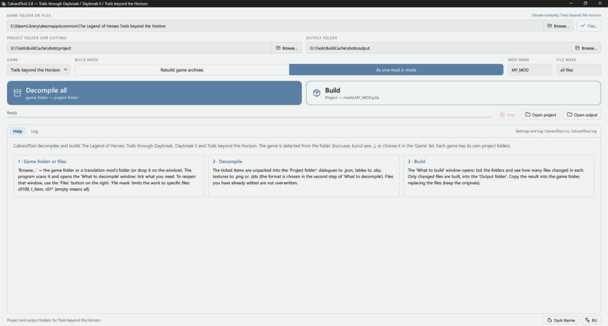
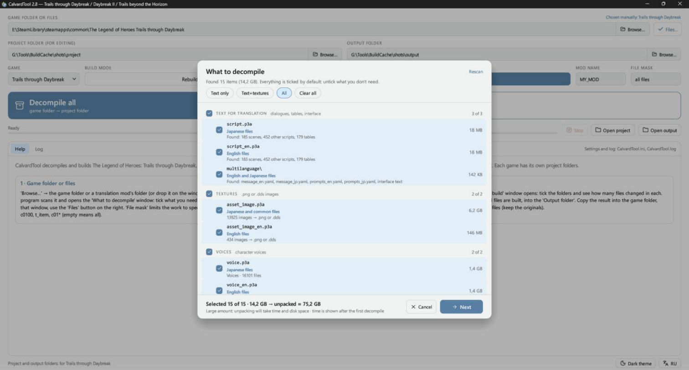
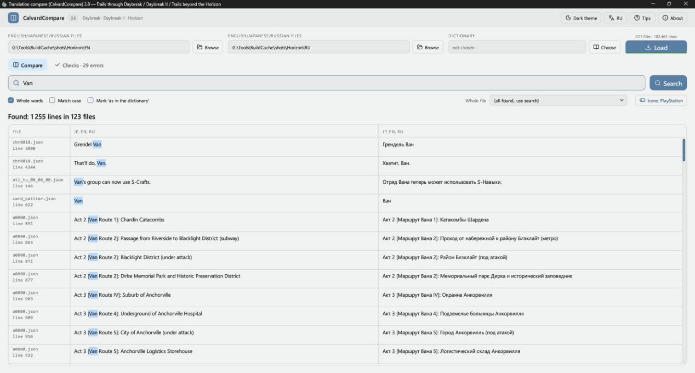
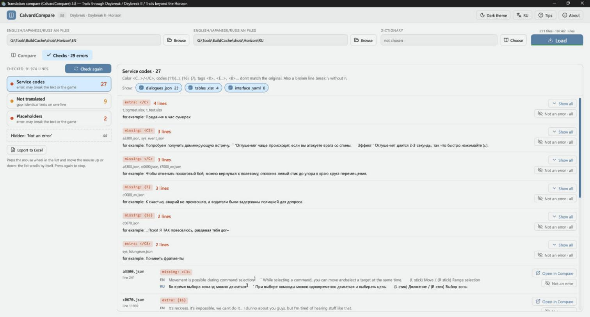

# CalvardTool

[English](README.md) · **Русский**

Сборка, извлечение и вычитка текстов игр The Legend of Heroes (PC, Steam): Trails through Daybreak, Trails through Daybreak II и Trails beyond the Horizon.

| Программа | Что делает |
|---|---|
| **CalvardTool** (`CalvardTool.exe`) | Разбирает архивы игры `.p3a` на файлы для правки и собирает правки обратно: в архивы игры или в один мод. |
| **CalvardCompare** (`CalvardCompare.exe`) | Показывает текст двух языков рядом, с поиском, словарём и автоматическими проверками перевода. Файлы перевода только читает и ничего в них не пишет. |

Интерфейс на английском и русском. При первом запуске он английский; кнопка **RU / EN** переключает язык и запоминает выбор. В CalvardTool она внизу окна, в CalvardCompare вверху. Проверки и словарь CalvardCompare рассчитаны на русский перевод: текст на кириллице считается переведённым, а английский сравнивается с русским.

Обеим программам нужны Windows и видеокарта с OpenGL 2 и выше. В виртуальных машинах они могут не запуститься.

Ниже названия кнопок указаны как в русском интерфейсе.

## Содержание

- [Скриншоты](#скриншоты)
- [Быстрый старт](#быстрый-старт)
- [CalvardTool](#calvardtool-1)
- [CalvardCompare](#calvardcompare)
- [Командная строка](#командная-строка)
- [Сборка из исходников](#сборка-из-исходников)
- [Авторы](#авторы)

## Скриншоты

CalvardTool:





CalvardCompare:





## Быстрый старт

1. Скачайте архивы из [Releases](../../releases) и распакуйте в любую папку. `data.dat` должен лежать рядом с `CalvardCompare.exe`: в нём значки и портреты из игр, которые показываются в тексте.
2. В CalvardTool укажите папку игры в поле **Папка игры или файлы** или перетащите папку на окно.
3. В окне **Что разбирать** отметьте нужное.
4. Укажите **Куда сохранять для правки** и на вкладке **Сборка** отдельную папку в **Куда сохранять собранное**.
5. Нажмите **Декомпилировать всё** и правьте файлы в папке проекта.
6. Нажмите **Собрать**, отметьте папки в окне **Что собрать** и запустите сборку.
7. Скопируйте результат в папку игры с заменой.

Сохраните копию оригиналов: Steam может восстановить изменённые архивы при проверке файлов.

Подробные инструкции: [CalvardTool](docs/RU/ReadMe_CalvardTool.txt), [CalvardCompare](docs/RU/ReadMe_CalvardCompare.txt).

## CalvardTool

### Поддерживаемые игры

| Игра | Определяется по | Папки с текстом |
|---|---|---|
| Trails through Daybreak | `kuro.exe` | `script_en`, `table_en` |
| Trails through Daybreak II | `kuro2.exe` | `script_en`, `table_en` |
| Trails beyond the Horizon | `kai.exe` или `script_eng.p3a` | `script_eng`, `table_eng` |

Игра определяется сама, или её можно выбрать в списке **Игра**. У каждой игры свои папки проекта и сборки, а файлы другой игры в папку проекта программа не разберёт.

### Что во что превращается

| Содержимое | В игре | Для правки | Чем править |
|---|---|---|---|
| Диалоги и скрипты | `.dat` | `.json` | Notepad++ или любой текстовый редактор |
| Таблицы | `.tbl` | `.xlsx` или `.json` | Excel или WPS; любой текстовый редактор |
| Текстуры | `.dds` | `.png` или `.dds` как есть | Любой графический редактор; для `.dds` с поддержкой DDS |
| Надписи интерфейса | `multilanguage\message_en.yaml` | `.yaml` | Любой текстовый редактор |
| Модели, эффекты, звуки | как есть | как есть | Положите свой файл с тем же именем на место старого |

Правила правки:

- **Диалоги:** переводите только строки в `"text"`. `\n` означает перенос строки. Оставляйте на месте `{11}{1180}` и другие `{числа}`, не трогайте `<C1>`, `<W500>` и другие теги. `"code"` и `"ln"` служебные поля.
- **Таблицы:** на листе `Text` в столбце A указано, где находится строка, в B текст для правки, в C оригинал. Не трогайте скрытый столбец D и лист `_internal`, не удаляйте и не переставляйте строки.
- **Текстуры:** сохраняйте `.png` с прозрачностью, размер лучше не менять.

Какая модель и какой ID у какого персонажа, указано отдельно для каждой игры (имена на английском): [Daybreak](docs/RU/character_models_daybreak.md), [Daybreak II](docs/RU/character_models_daybreak2.md), [Horizon](docs/RU/character_models_horizon.md).

### Разборка

В окне **Что разбирать** архивы разделены на группы: текст для перевода, моды, текстуры, озвучка, музыка и звуки, модели, видео и остальное. У каждого архива видно, что внутри, на каком он языке и сколько весит. Внизу показано, сколько выбрано, сколько займут разобранные файлы и примерно сколько времени это займёт.

- **Быстрый выбор:** **Только текст**, **Текст+текстуры**, **Всё**, **Снять всё**.
- **Маска файлов:** разбирает только нужные файлы, например `c0100, t_item, c01*`.
- **Ваши правки в безопасности:** уже изменённые файлы при повторной разборке не перезаписываются.
- **Место на диске:** если объём больше 1 ГБ, программа сначала спросит, а если места мало, предупредит.
- **Установленные моды:** мод в `mods\*.p3a` главнее архивов игры. Английские оригиналы заменённых им файлов кладутся в папку проекта `_english` для CalvardCompare.
- **Японский текст:** сцены и таблицы из `script.p3a` тоже разбираются, в папку проекта `script`.

Структура проекта повторяет игру, каждый архив становится папкой:

```
Проект\script_eng\script_eng\scena\a0000.json      из script_eng.p3a
Проект\script_eng\table_eng\t_name.xlsx
Проект\mods\RU_MOD\script_eng\scena\a0000.json     из mods\RU_MOD.p3a
Проект\multilanguage\message_en.yaml
```

Служебные файлы не трогайте: `.kai_*.tsv` и папки `_original` и `_english`.

### Сборка

Выберите режим в **Как собирать**:

- **Пересобрать архивы игры:** каждая папка проекта возвращается в свой архив, пересобираются только архивы с изменениями. Папка собранного должна отличаться от папки игры, потому что архивы собираются из оригиналов.
- **Одним модом в mods:** все изменения попадают в один `mods\<Имя мода>.p3a`, архивы игры не меняются.

Собираются только изменённые файлы. Без правок файлы собираются байт в байт как оригинал.

Проверки при сборке:

- Перед записью архивов проверяется место на диске.
- Архив пишется через временный файл, поэтому при сбое прежний архив остаётся целым.
- После записи архив открывается заново, каждый файл распаковывается и сравнивается с собранным.
- Сборка останавливается, если в переводе сломаны служебные коды или подстановки. Их можно исправить или собрать всё равно.
- Перед сборкой в папку игры программа спрашивает подтверждение.

## CalvardCompare

### Загрузка

- **Левое поле:** оригинал. Это может быть сама папка игры, папка проекта CalvardTool с английскими файлами или папка проекта `script` для японского текста.
- **Правое поле:** перевод, папка проекта CalvardTool. Можно указать одну и ту же папку проекта в обоих полях: русский берётся из `mods`, английский из файлов игры и `_english`.

Нажмите **Загрузить** или перетащите папки на окно. При следующем запуске программа откроется там, где вы остановились.

Строки сопоставляются по устройству скрипта, а не по номеру, поэтому лишняя строка не сбивает остальные. Если файлы с двух сторон из разных игр, вместо строк появится предупреждение. Текст с меткой `—НЕ ТРОГАТЬ—` это служебное имя, его правка сломает игру.

### Поиск

- Находятся строки, где слово есть хотя бы в одном столбце. Если слов несколько, находятся строки, где есть все.
- **Целые слова** и **Учитывать регистр** сужают поиск. Буквы ё и е считаются одной, а тире любого вида, кавычки и многоточие одинаковыми.
- **Файл целиком** показывает все строки одного файла по порядку.
- Правый клик по строке копирует её или открывает файл на этой строке: `.json`, `.yaml` и `.txt` в Notepad++, `.xlsx` в Excel или WPS.

### Словарь

Словарь выбирается кнопкой **Выбрать**. Он подсвечивает термины, а **Отмечать «как в словаре»** делает строку зелёной, если в переводе стоят слова из словаря. Файл можно обновить, не закрывая программу.

Форматы:

```
JSON:   {"Bracer": "брейсер", "Spriggan": ["спригган", "спригганша"]}
        [{"en": "Bracer", "ru": "брейсер"}]

Текст:  Bracer = брейсер
        Bracer:Брейсер
        Shizuna:Шизуна-Шизуны-Шизуне
        # комментарий
```

Текстовые файлы могут быть в UTF-8 или Windows-1251.

### Проверки

Проверки запускаются в фоне после загрузки, на вкладке видно число ошибок.

| Раздел | Что находит |
|---|---|
| **Служебные коды** | Потерянные или лишние коды (`<C…>`, `</C>`, `{11}{…}`, `{16}`, `<K>`, `<E…>`, `<B>`), сломанные переносы, изменённые служебные имена, файлы `.json`, которые не читаются |
| **Не переведено** | Реплики сцен без перевода, целиком или частично; для пары японский и английский — японский текст в английских файлах. Таблицы, интерфейс и отладочные сцены не проверяются |
| **Подстановки** | `%d`, `%s`, `%.1f`, куда игра подставляет число или имя; если их не столько же, сколько в оригинале, игра может показать не то или упасть |

- Одинаковые ошибки собраны в группы, с файлами и примером.
- **Открыть в сверке** переходит к строке, а **Не ошибка** скрывает находку. Скрытые находки можно вернуть.
- **Выгрузить в Excel** сохраняет находки в `.xlsx`, по листу на раздел, с пятью репликами до и после каждой.

Что означает каждый служебный код, описано в [подробной инструкции](docs/RU/ReadMe_CalvardCompare.txt).

### Значки и портреты

- Коды `<I…>` могут показываться картинками из текстур игры: для PlayStation, Xbox, Switch, Steam Deck, Stadia, клавиатуры и мыши. Код без значка можно один раз назначить в окне **Значки**.
- У реплик из `t_active_voice.xlsx` и у реплик сцен показывается портрет говорящего: он находится по ID персонажа в реплике. У персонажей без портрета в Active Voice его нет.

Это влияет только на показ, в файлы ничего не пишется.

### Горячие клавиши

| Клавиши | Действие |
|---|---|
| Ctrl+F | Перейти в поле поиска |
| Enter | Найти |
| F5 / Shift+F5 | Загрузить заново / загрузить заново без кэша |
| Ctrl+1 / Ctrl+2 | Вкладка «Сверка» / «Проверки» |
| Ctrl+C | Скопировать столбец, по которому щёлкнули |
| Ctrl+колёсико, Ctrl+плюс/минус, Ctrl+0 | Размер текста таблицы |
| F11 | Во весь экран |
| Esc | Закрыть окно или меню, выйти из полноэкранного режима |

## Командная строка

```
CalvardTool decompile --game <папка игры или файл .p3a> --proj <папка проекта>
            [--types scena,tables,textures,other] [--mask a0000,c01*] [--no-mods] [--overwrite] [--dds] [--tables-json]
CalvardTool compile   --proj <папка проекта> --out <папка результата>
            [--rebuild --game <папка игры> | --name RU_MOD] [--changed]
CalvardTool extract   --game <папка игры> --proj <папка> --mask chr0000*
CalvardTool file <файл> [daybreak|daybreak2|horizon]

CalvardCompare <английская папка> <русская папка> <слово>
```

`CalvardTool file` переводит один `.dat`, `.tbl` или `.dds` в `.json`, `.xlsx` или `.png` и обратно. Для `.xlsx` и `.png` рядом нужен оригинал с тем же именем, а к имени результата добавляется `_new`.

## Сборка из исходников

Нужны Windows, [Rust](https://rustup.rs) и Visual Studio Build Tools с Windows SDK. Версия компилятора указана в `rust-toolchain.toml`.

```
cargo build --release -p calvard-tool
```

Программы появятся в `target\release`. `data.dat` для CalvardCompare в репозитории нет, потому что в нём картинки из игр; он лежит в архивах релиза. Без него значки и портреты не показываются.

## Авторы

В папке `libs` лежат изменённые копии этих библиотек. Вся заслуга за них принадлежит их авторам:

- **Kyuuhachi**, [Aureole Suite](https://aureole.kyuuhachi.dev): `calmare`, `themelios` и его крейты `themelios-*`, `cradle`, `gospel`, `gospel-dump`, `cp932`, `bc7`, `bzip`.
- **Kyuuhachi**, Ingert, декомпилятор скриптов Trails through Daybreak и более поздних игр: `ingert`, `ingert-syntax`.
- [KuroTools](https://github.com/nnguyen259/KuroTools) (MIT): схемы таблиц.
- [Lucide](https://lucide.dev): значки интерфейса, см. [лицензию](tool/src/icons/LICENSE).

The Legend of Heroes и все материалы игр принадлежат Nihon Falcom. Это неофициальный фанатский проект, для работы нужны ваши собственные копии игр.
